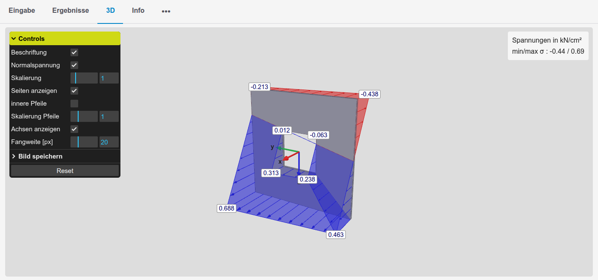

# polyQuer – Querschnittswerte polygonaler Querschnitte

Eine einfache Web-App für Vorlesung und Übung: Sie berechnet die Querschnittswerte eines beliebigen
polygonal begrenzten Querschnitts und die Normalspannungen aus Längskraft und schiefer Biegung.
Sie läuft im Browser auf Smartphone, Tablet und PC, lässt sich als App installieren (PWA) und
funktioniert danach auch offline. Bedienung mit Maus, Stift oder Finger.

## Funktionen

- Eingabe des Querschnitts als Polygon, auch mit Löchern
- Schwerpunkt, Fläche, Flächenmomente 2. Grades I<sub>y</sub>, I<sub>z</sub>, I<sub>yz</sub>,
  Hauptträgheitsmomente I<sub>1</sub>, I<sub>2</sub> und Hauptachsenwinkel
- Normalspannungen σ aus N, M<sub>y</sub> und M<sub>z</sub> in allen Eckpunkten
- 2D-Grafik mit Schwerpunkt- und Hauptachsen; Koordinaten und Werte unter dem Cursor bzw. Finger,
  Einrasten an Eckpunkten und Schwerpunkt
- 3D-Darstellung des Spannungskörpers (Druck rot, Zug blau) mit Spannungspfeilen, drehbar und
  zoombar; Werte der Pfeilspitzen unter dem Cursor; Export als PNG in hoher Auflösung
- Punkte-Tabelle mit Zeilen einfügen/löschen, Rückgängig/Wiederherstellen und Kontextmenü
  (Kopieren, Hochzählen, Zwischenablage)
- Eingabe speichern und einlesen (Dateiendung `.polyquer`, auf Android `.polyquer.json`; ältere
  `.txt`-Dateien lassen sich weiter einlesen), Öffnen auch per Drag & Drop; Rückfrage nur bei noch
  nicht gespeicherten Änderungen. Die letzte Eingabe wird im Browser gesichert und beim nächsten
  Start wiederhergestellt
- Farben der Tabellen und Akzentfarbe einstellbar, helles und dunkles Design



## Ausprobieren

Die aktuelle Version läuft unter https://polyquerschnitt.netlify.app 😊

## Eingabe

- Die Punkte werden **gegen den Uhrzeigersinn** eingegeben, so wie in der Grafik dargestellt
  (y&#772; nach links, z&#772; nach unten). Ist der ganze Umriss im Uhrzeigersinn eingegeben, kehrt
  die App die Reihenfolge automatisch um und weist darauf hin.
- **Löcher** werden über einen Schlitz eingegeben: vom Außenrand zum Loch, den Lochrand
  **im Uhrzeigersinn** umlaufen und auf derselben Kante zurück. Das Startbeispiel (ein Rechteck
  mit Loch) zeigt das.
- Einheiten: Koordinaten in cm, N in kN, M<sub>y</sub> und M<sub>z</sub> in kNm, Spannungen in kN/cm².

Eine kurze Bedienungsanleitung steht in der App im Tab *Info*. Die Buttons zeigen einen
Hilfetext, wenn man mit der Maus darüberfährt oder mit dem Finger länger darauf drückt.

## Entwicklung

Benötigt Node.js ≥ 20.19 (Vite 8), empfohlen Node 22.

```bash
npm install
npm run dev        # Entwicklungsserver, öffnet den Browser
npm run build      # Typprüfung (tsc) und Build nach dist/
npm run preview    # Build und Vorschau des fertigen Builds (inkl. Service Worker)
```

Auf Netlify wird bei jedem Push nach `master` automatisch gebaut (`netlify.toml`).

### Technik

- [Vite](https://vite.dev) + TypeScript, PWA mit [vite-plugin-pwa](https://vite-pwa-org.netlify.app)
- Oberfläche mit [Lit](https://lit.dev) und [Shoelace](https://shoelace.style) im Stil von
  [d2beam-gui](https://d2beam-gui.netlify.app)
- 2D-Grafik mit [Two.js](https://two.js.org), 3D-Grafik mit [three.js](https://threejs.org)
  (wird erst beim ersten Rechnen nachgeladen) und [lil-gui](https://lil-gui.georgealways.com)

### Aufbau

| Datei | Inhalt |
|---|---|
| `src/index.ts` | Start, Verdrahtung der Oberfläche |
| `src/components/dr-haupt.ts` | Oberfläche mit den Tabs (Lit, ohne Shadow DOM) |
| `src/calc/quer1.ts`, `src/calc/spannung.ts` | Querschnittswerte und Spannungsformel |
| `src/rechnen.ts` | Berechnung und Ausgabe der Ergebnisse |
| `src/grafik.ts`, `src/trans.ts` | 2D-Grafik |
| `src/grafik3d.ts` | 3D-Ansicht |
| `src/punkte.ts` | Zugriff auf die Punkte-Tabelle |
| `src/dateien.ts`, `src/autosave.ts` | Speichern/Einlesen, automatische Sicherung |
| `src/einstellungen.ts` | Tab ꔷꔷꔷ (Farben) |
| `icon-quelle/polyquer.svg` | Vorlage für die App-Icons in `public/` |

### Gemeinsame Komponenten mit d2beam-gui

`dr-tabelle`, `dr-button-pm`, der Bestätigungsdialog (`confirm_dialog.ts`) und die Hilfetexte
(`touch_hint.ts`) stammen aus d2beam-gui. `dr-tabelle.ts` ist dort und hier bis auf die
Import-Zeilen identisch; die Abhängigkeiten von d2beam-gui werden hier über
`src/components/tabelle_umgebung.ts` ersetzt. Änderungen an der Tabelle sollten deshalb in
beiden Projekten nachgezogen werden.

## Kontakt

Rückmeldungen und Fehlerberichte gerne als Issue oder per E-Mail an statikverstehen&#x40;web.de.

© [statikverstehen.de](https://statikverstehen.de)
